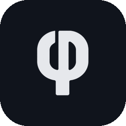

<p align="center"></p>

<h1 align="center">miniPhi</h1>

<p align="center">The same kernel, drivers and apps, on every board.</p>

---

miniPhi is a small RTOS. The kernel, the drivers and the apps are the same on every board. What a firmware contains is chosen in the window under `config/`: the board, the app, the modules. The window reads the `_phi.js` file next to each directory, checks the pins and the RAM, and writes `build/`. `make` compiles `build/` and nothing else.


## Build

Node.js, then:

```
make config     # npm ci, open the window, press Write build/
make            # compile build/
make flash      # the probe the board names
make test       # host tests, no board
make doc        # docs/referencesManual.pdf
```

The window names the compiler and the flash tool this selection needs. Their paths are settings in the window.

## Tree

```
arch/       clocks, pins, gates, and the mp_* calls
boards/     one directory per board, and the probes
common/     the kernel, and the modules the window turns on
drivers/    a chip on a bus
app/        sysinfo, the app shipped in the tree
config/     the window; it is not linked into the firmware
```

`drivers/`, `common/` and `app/` include `mp.h`. The chip stays in `arch/`. [`DESIGN.md`](DESIGN.md) describes each module, the `_phi.js` files, and what a port has to provide.

## common/

A module is a directory the window can turn on. Tasks and power stay on: the kernel runs the tasks, then lets power decide the clock.

**The loop**

- **TASK** is a callback in a fixed table. The build picks the scheduler. When that scheduler is preemptive, a task above priority 0 has its own stack, and two tasks of the same priority can share a tick.
- **POWER** has four levels, High, Medium, Low and Sleep. It measures how much of the loop was awake. The level rises at once and falls only after a few quiet seconds, because moving the clock costs a relock. A hold is a floor under the frequency, or a veto that keeps the chip from stopping at Sleep.

**Memory**

- **MEM** hands out fixed-size chunks from a static pool, so the pool cannot fragment. A double free, a stray free and an overrun are caught.
- **CIRCULAR** builds its queues from those chunks. A write that does not fit is refused whole, and the caller retries once the queue has drained.
- **KFLASH** keeps small values in the last two pages of the internal flash. They are appended, so a page is erased only when it fills, and the module that owns a key is called back when the value changes.

**Devices**

The app asks for a class and a rank. The board file is what attaches that to a chip and to pins.

- **DEVICE** is that request. The classes are display, touch, accelerometer, LED, pixel, camera, charger, PHY and block. Opening a device starts its driver.
- **SPI** and **I2C** are one shared master for a set of pins, synchronous, around 100 kHz. Chip select stays with the device.
- **REGMASTER** queues register reads and writes on those buses. The sensor drivers use it.
- **DMA** is map, start, done, unmap, with the engine hidden behind it. The copy done by the CPU is a task.
- **FS** is one struct per medium: read sectors, write sectors, and the count when the medium knows it. The caller owns the struct.
- **BUTTON** is a GPIO and a level, with no controller. **RESISTIVE** is a 4-wire sheet, two ADC channels, no controller either. Both register as ordinary devices, and sampling starts with the first subscriber.
- **PINOUT** plays a timed pattern on a GPIO.

**The console**

One UART, and one owner at a time.

- **SERIAL** buffers it. Printk can be wired there, and each byte received holds the chip out of deep sleep for a while.
- **TERMINAL** takes the line, and printk loses it. The app asks for a cursor move or a colour; the codec writes what that peer understands, and bytes coming back arrive as text, keys, mouse, paste, resize and OSC. The codec does not own the transport.
- **COMMANDER** is a named call with typed parameters. A module exports it, a transport invokes it. With the module off, the calls compile to nothing.

**Screens**

A 320 by 240 frame in RGB565 is 150 KB, which is more RAM than the smaller boards have. Both screens draw a band and keep no framebuffer.

- **TUI** is the pointer interface: a splash, then a home of the apps the firmware registered. Its fonts and the splash mark are rasterized when `build/` is written.
- **PUI** is the pager, driven by one or two buttons. Widgets speak RGB888, and the display picks 1, 16 or 24 bits for the band.

**Crypto**

One family per kind of operation, under `common/crypto/`. Requiring an algorithm pulls it into the binary. The caller owns every context and every buffer.

- **HASH**, **MAC**, **CIPHER**, **MODE**, **KDF**, **SIGN** and **KEM** each have one call shape, and the algorithm is a name: `"SHA256"`, `"HMAC-SHA256"`, `"AES"` with `"GCM"`.
- **RNG** is HMAC-DRBG, started with the kernel and reseeded from the HSM when the series has one, from the die sensors otherwise. A draw returns false until the first seed has landed.
- **BN** is the fixed-width arithmetic under the signatures. One operation runs at a time.
- **FUSE** names the key slots when the series has them, and checks that a burned purpose matches the role asked for.
- **SELFTEST** is the known answers. Nothing runs at boot; the app calls `mp_crypto_selftest("AES")` when it wants to check the implementation it will actually use.

**On the numbers, and on the wire**

- **KALMAN** filters one noisy axis.
- **QUATERNION** turns an accelerometer, a gyroscope and an optional magnetometer into a quaternion and Euler angles, with Madgwick or Mahony.
- **HCI** is the Bluetooth host on a UART: it resets the controller, keeps the credits, and cuts and reassembles L2CAP frames. RTS rises when the task falls behind.
- **USB** lists the PHY ports and locks one to device or host. It queues link events and stops before endpoints and classes.

## sysinfo

On a console, the banner, then the board, the clock, the memory and the tasks. On a display, this screen.


## License

GPL-3.0-or-later. Copyright (C) 2014 Michael VERGOZ.
