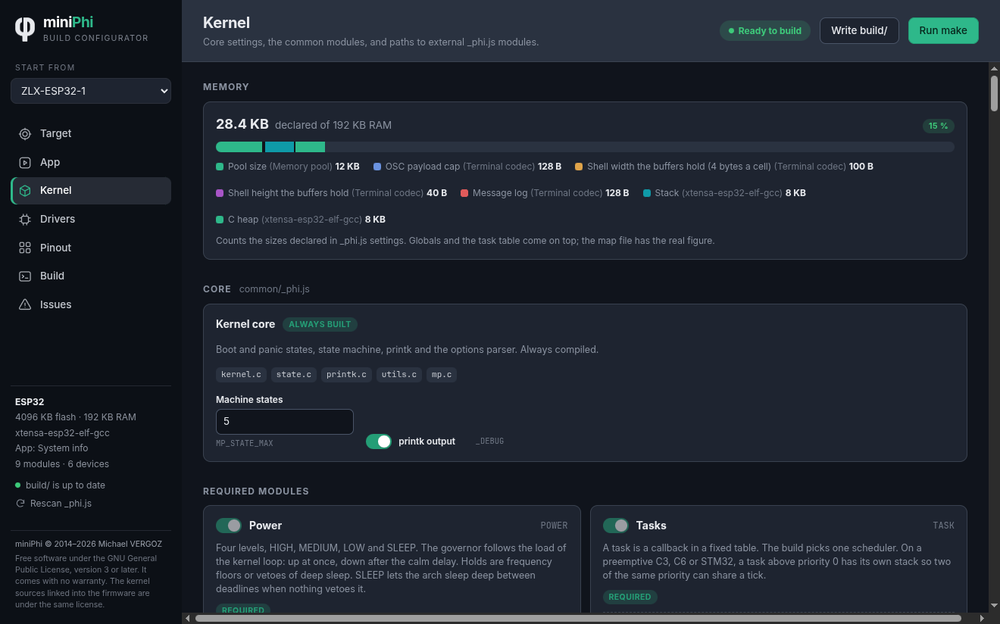
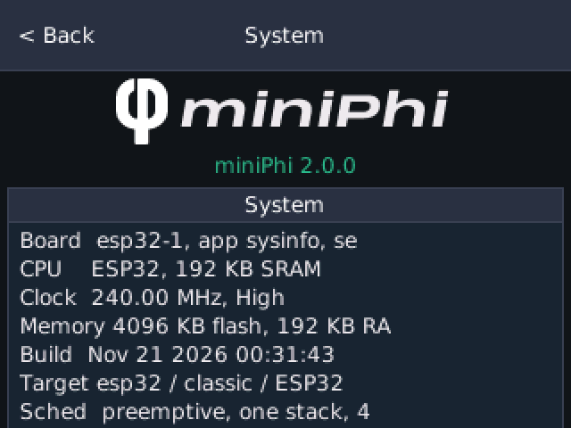

<p align="center"></p>

<h1 align="center">miniPhi</h1>

<p align="center"><strong>A compact, configurable RTOS for embedded systems.</strong></p>

<p align="center">One kernel, a common driver API, and a build tailored to the board you choose.</p>

<p align="center">
<a href="https://www.gnu.org/licenses/gpl-3.0.html"></a>

</p>

miniPhi is an embedded real-time operating system written in C. Portable application and kernel code stay apart from the MCU-specific implementations, and a desktop configurator assembles the components a firmware needs.

You describe the hardware, choose an application and the modules, and the configurator writes a build directory. It resolves the dependencies, checks the pins and the RAM, and produces the Makefile and the headers the target compiler uses.

> **Project status.** A module or a board file in the tree means the port exists. It does not, by itself, promise that every feature of that module has been exercised on every board. USB lists PHY ports and link state. It has no endpoints and no device classes.

## At a glance

| | |
| --- | --- |
| **Core** | Tasks, system state, the power governor, logging |
| **Hardware** | Architecture code behind the common `mp_*` API |
| **Build** | An Electron window driven by the `_phi.js` file next to each directory |
| **Devices** | A registry by class, plus UART, SPI, I²C, DMA and the drivers |
| **Modules** | Memory pools, queues, flash settings, screens, crypto, and the rest under `common/` |
| **Application** | `sysinfo`, which reports the firmware and the hardware it is running on |

**[Quick start](#quick-start) · [Architectures](#supported-architectures) · [Architecture](#architecture) · [Modules](#module-overview) · [Extending](#extending-miniphi) · [Design reference](DESIGN.md)**

## Quick start

### Requirements

- **Node.js and npm**, recent enough for the Vite and Electron versions in `config/`.
- **GNU Make.**
- **The toolchain the configurator names** for the selected MCU.
- **The probe and its tool**, when you want to flash.
- **GCC on the host**, for `make test`.

`make config` opens a window, so it needs a display.

### Configure

```bash
git clone https://github.com/mykiimike/miniPhi.git
cd miniPhi
make config
```

`make config` runs `npm ci` and starts the window. In it:

1. Select a board.
2. Select the application. The tree ships `sysinfo`.
3. Review the modules, the devices, the pins, the RAM and the settings.
4. Set the toolchain path, and the flash tool path when the board asks for one.
5. Press **Write build/**.

`build/` is generated and is not tracked by Git.



### Build and flash

```bash
make all      # compile the firmware in build/
make flash    # program the board with the probe it names
```

> **`make` alone runs the host tests.** In the root Makefile the first target is `test`. Compiling the firmware is `make all`.

### Commands

| Command | Purpose |
| --- | --- |
| `make config` | Install the configurator dependencies and open the window |
| `make all` | Compile the firmware described by `build/` |
| `make flash` | Flash through the probe the board names |
| `make clean` | Clean a generated build |
| `make test` | Compile and run the host tests with GCC |
| `make doc` | Generate the reference manual |

`make doc` needs Doxygen and a LaTeX toolchain. It writes `docs/referencesManual.pdf`.

## Architecture

The shared tree is the kernel, the drivers and the apps. The architecture directory and the board file are what change from one target to the next.

```text
arch/       MCU-specific code ───────┐
boards/     board and probe records ─┤
common/     kernel and modules ──────┼──> config/ ──> build/ ──> firmware
drivers/    chips on a bus ──────────┤    window      Makefile
app/        applications ────────────┘                headers
```

The window reads the `_phi.js` next to the code it describes. Those files declare the sources, the dependencies, the settings, the pins and the tools. It then resolves the selection, checks pins and RAM, checks the tools, and writes `build/`. The window is not linked into the firmware.

### What gets generated

```text
build/
├── config.js            # the selection the window reopens
├── Makefile             # toolchain, sources, compile and flash rules
└── include/             # the only -I
    ├── autoconf.h       # PHI_BUILD_*, SUPPORT_* and the settings
    ├── pinout.h         # one options initializer per device
    ├── gen/             # fonts, the splash mark, device storage
    └── arch/            # headers of the selected architecture
```

A module that was not selected is absent from the build. The `_phi.js` format, the generation hooks and the checks are in [DESIGN.md](DESIGN.md).

## Supported architectures

The ports in the tree:

| CPU | Profile |
| --- | --- |
| **MSP430 / MSP430X** | 16-bit, with the extended MSP430X instructions |
| **Arm Cortex-M3** | ARMv7-M |
| **Arm Cortex-M4** | ARMv7E-M, with the DSP instructions |
| **Arm Cortex-M33** | ARMv8-M |
| **Xtensa LX6** | Two cores |
| **Xtensa LX7** | |
| **RV32IMC** | RISC-V |
| **RV32IMAC** | RISC-V, with the atomic extension |

A CPU port is not a promise about every MCU that uses that core. A firmware still needs the series, the memory map, the drivers and a board file.

## Module overview

The modules live under `common/`. **TASK** and **POWER** are always on. The others are selected, and a selection can pull in the modules it depends on.

| Area | What it does |
| --- | --- |
| **Scheduling and power** | `TASK` runs callbacks from a fixed table. The build picks the scheduler. With a preemptive one, a task above priority 0 has its own stack, so two of the same priority can share a tick. `POWER` has four levels, High, Medium, Low and Sleep. It measures how much of the loop was awake, rises at once and falls after a few quiet seconds. A hold is a floor under the frequency, or a veto of Sleep. |
| **Memory and storage** | `MEM` is a static pool of fixed blocks, so it does not fragment, and a bad free is caught. `CIRCULAR` builds queues from those blocks and refuses a write that does not fit. `KFLASH` appends small values in the last two pages of internal flash. `FS` is one struct per medium: read sectors, write sectors, and the count. |
| **Buses** | `SPI` and `I2C` are one shared synchronous master per set of pins, around 100 kHz. Chip select stays with the device. `REGMASTER` queues register access for the sensor drivers. `DMA` is map, start, done, unmap. The CPU copy is a task. |
| **Devices** | `DEVICE` finds a peripheral by class and rank: display, touch, accelerometer, LED, pixel, camera, charger, PHY, block. The application does not name the driver. Opening it starts the driver. |
| **Console and commands** | `SERIAL` buffers a UART and can carry printk. `TERMINAL` takes that line and speaks ANSI to whatever peer is on the other end. `COMMANDER` is a named call with typed parameters. |
| **Screens and input** | `TUI` and `PUI` draw a band and keep no framebuffer. `BUTTON` is a GPIO and a level. `RESISTIVE` is a 4-wire sheet and two ADC channels. `PINOUT` plays a timed pattern on a GPIO. |
| **Cryptography** | One family per kind of operation, under `common/crypto/`: hash, MAC, cipher, mode, KDF, signature, KEM, plus `RNG`, `BN` and `SELFTEST`. The caller owns every context and every buffer. A known-answer test runs when the application calls it. |
| **Sensors and links** | `KALMAN` filters one axis. `QUATERNION` fuses an accelerometer, a gyroscope and an optional magnetometer. `HCI` is a Bluetooth host on a UART. `USB` lists the PHY ports and stops before endpoints and classes. |

A 320 by 240 frame in RGB565 is 150 KB. That is why the screens draw a band. Tasks sleep until the next deadline, and the governor is what then slows or stops the clock. [DESIGN.md](DESIGN.md) has the API and the limits of each module.

## The sysinfo application

`sysinfo` is the application shipped in the tree. On a console it prints the banner, then the board, the clock, the memory and the tasks. On a display it opens the screen below. It reads the system through the common API.



## Repository layout

```text
miniPhi/
├── app/         applications, including sysinfo
├── arch/        one directory per family, and the series under it
├── boards/      board files, probes and flash scripts
├── common/      the kernel and the modules
├── config/      the Electron window that writes build/
├── data/        the phi used by the splash
├── docs/        Doxygen configuration and the generated manual
├── drivers/     a chip on a bus
├── hats/        add-on hardware
├── Makefile     the commands above
└── DESIGN.md    the reference for modules, _phi.js and ports
```

## Extending miniPhi

A component is a directory with a `_phi.js` beside its sources.

**A board** is `boards/<vendor>/<board>/_phi.js`: the architecture, the MCU, the devices, the pins and the probe. Reopen the window and it is in the list.

**A module or a driver** goes in `common/<module>/` or `drivers/<category>/<driver>/`, with its sources and a `_phi.js` that names what it needs, its settings and its pins.

**An application** is the same kind of record, with its sources and its dependencies. It reaches hardware through `mp_*` and through `DEVICE`.

The record format, the generated headers and the porting contract are in [DESIGN.md](DESIGN.md).

## Testing and documentation

```bash
make test
```

`config/test.js` finds the tests declared in the `_phi.js` files, compiles them with the host GCC and runs them. That is not a substitute for running the firmware on a board.

```bash
make doc
```

## Contributing

Ports, fixes and documentation are welcome. Read [DESIGN.md](DESIGN.md) first, keep the chip out of `drivers/`, `common/` and `app/`, and run `make test`. A change to a port should also be tried on the board it is for.

## License

GPL-3.0-or-later. Copyright (C) 2014 Michael VERGOZ.
